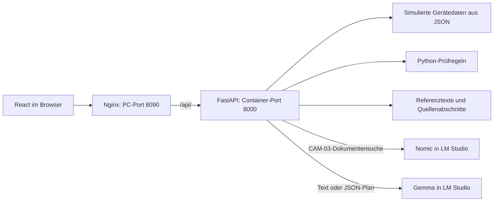

# Lokaler Kamera-Service-Assistent mit RAG & Axis-Proof-of-Concept

Ein Projekt für die dokumentengestützte Unterstützung bei Kamerastörungen. Der Assistent durchsucht Wartungsunterlagen, zeigt simulierte Gerätedaten und erstellt Servicevorschläge mit Quellen. Die Bedienung erfolgt über eine React-Oberfläche; Sprachmodelle laufen lokal über LM Studio. Python übernimmt die Datenverarbeitung, Temperaturprüfung und formale Prüfung des CAM-03-Prüfplans.

Der Axis-Proof-of-Concept behandelt den Fall **„Kein Videobild“ bei einer AXIS M2035-LE** anhand offizieller Handbuchnotizen und drei simulierten Servicefällen. Es ist keine reale Kamera angeschlossen.

# Benutzeroberfläche im Browser


---

# Verwendete Software

| Komponente | Aufgabe |
| :--- | :--- |
| **Python / FastAPI** | Service-API, Datenverarbeitung und Prüfregeln |
| **React / Vite** | Browseroberfläche und lokale Frontend-Entwicklung |
| **LM Studio / Gemma** | Lokale Textantworten und Servicevorschläge |
| **Nomic Embed Text** | Embeddings für die semantische Dokumentensuche |
| **MCP Python SDK** | Separater Werkzeugserver und stdio-Client |
| **Docker Compose / Nginx** | Gemeinsamer Start und Weiterleitung der API-Anfragen |
| **unittest** | Automatisierte Python-Tests ohne laufendes Sprachmodell |

Getestet mit Python 3.14.7 und Node.js 24.21.0. Direkte Python-Paketversionen stehen in `requirements.txt`; die Frontend-Versionen sind zusätzlich im `package-lock.json` festgehalten.
Es wurde das Model Gemma 4 12B QAT benutzt.

---

## Aufbau und Datenfluss



**Webserver und API laufen in Containern. Gemma und Nomic bleiben in LM Studio auf dem Windows-PC.** Der Axis-Zweig wählt Dokumentabschnitte über feste Python-Regeln aus. Der getrennte CAM-03-Zweig verwendet eine semantische Suche.

---

## Funktionen und Bedienung

### 1. Axis-Servicefälle

In der Oberfläche einen Servicefall auswählen und einen Vorschlag erstellen lassen:

| Szenario | Simulierter Geräteabruf | Videobeobachtung |
| :--- | :--- | :--- |
| `no_video` | Geräteinformationen verfügbar | Benutzerangabe: kein Videobild |
| `unreachable` | Keine rechtzeitige Antwort auf diesen Abruf | Nicht geprüft |
| `access_denied` | Zugriff abgewiesen | Nicht geprüft |

* **Getrennte Datenbasis:** Geräteabruf, Videobeobachtung und unbekannter Übertragungsmodus werden unabhängig von Gemmas Text angezeigt.
* **Quellen:** Eigene deutsche Zusammenfassungen offizieller Axis-Handbuchstellen enthalten Originalseiten, Dokumentkennung und Geltungsbereich.
* **Szenariowechsel:** Der alte Vorschlag verschwindet sofort, damit er nicht dem neuen Fall zugeordnet wird.
* **Begrenzter Vorschlag:** Gemma soll fehlende Angaben nennen und mögliche Prüfungen als noch durchzuführen kennzeichnen. Eine unzureichende Quellenlage darf ausdrücklich benannt werden.

### 2. Dokumentfragen mit RAG

Eine Frage zu den fiktiven CAM-03-Unterlagen eingeben. Nomic erzeugt Embeddings; Python sortiert die Abschnitte nach Kosinusähnlichkeit und sendet die drei ähnlichsten Fundstellen mit ihrem Geltungsbereich an Gemma. Die Antwort erscheint zusammen mit den tatsächlich mitgesendeten Quellen.

### 3. Simulierter Kamerastatus und Temperaturprüfung

Der CAM-03-Status wird aus einer JSON-Datei gelesen. Python prüft den internen Sensor `board_temperature` gegen den fiktiven Bereich von **0 bis einschließlich 80 °C**. Der feste Messzeitpunkt und die Simulationskennzeichnung bleiben sichtbar. Diese Regel gilt nicht für das Axis-Modell.

### 4. Strukturierter Optik-Prüfplan

Für das feste Szenario „CAM-03, unscharfes Bild“ erzeugt Gemma einen JSON-Plan mit drei bis fünf Schritten. Python prüft Pflichtfelder, den Status `pending` und erlaubte Quellenpaare vor der Ausgabe. Eine formale Freigabe beweist keinen inhaltlichen Quellenbeleg.

### 5. Tool Calling und MCP

Zusätzlich sind zwei unabhängig ausführbare Abläufe vorhanden: ein von Gemma vorgeschlagener und von Python geprüfter Werkzeugaufruf sowie ein MCP-Server mit stdio-Client. Die Browser-API verwendet direkte Python-Funktionsaufrufe; sie ist nicht über MCP mit den Geräten verbunden.

---

## Starten mit Docker Compose

### Voraussetzungen

1. Docker Desktop mit Linux-Containern starten.
2. In LM Studio den lokalen API-Server starten und seine Adresse prüfen.
3. Die Modelle `google/gemma-4-12b-qat` und `text-embedding-nomic-embed-text-v1.5` bereitstellen.

Die getestete LM-Studio-Adresse ist `http://localhost:1234/v1`, ohne Authentifizierung. Die Modell-IDs müssen tatsächlich unter `GET /v1/models` verfügbar sein. Abweichende Modell-IDs werden in `camera_service/lm_studio.py` angepasst. Für eine andere Serveradresse die Einstellung `LM_STUDIO_BASE_URL` in `compose.yaml` anpassen; authentifizierte LM-Studio-Verbindungen sind derzeit nicht implementiert.

Im Projektordner in PowerShell:

```powershell
docker compose up -d --build
```

Im Browser **http://127.0.0.1:8090** öffnen. Im Container verweist `host.docker.internal:1234` auf LM Studio auf dem Windows-Host.

Status prüfen und Logs anzeigen:

```powershell
docker compose ps
docker compose logs --tail 80 api web
```

Nach Code- oder Datenänderungen vollständig neu bauen und starten:

```powershell
docker compose down
docker compose up -d --build
```

Beenden:

```powershell
docker compose down
```

---

## Lokale Entwicklung und Tests

Im Projektordner:

```powershell
python -m venv .venv
.\.venv\Scripts\python.exe -m pip install -r requirements.txt
.\.venv\Scripts\python.exe -m uvicorn camera_service.api:app --host 127.0.0.1 --port 8000
```

In einem zweiten Terminal:

```powershell
Set-Location frontend
npm.cmd ci
npm.cmd run dev
```

Die Entwicklungsoberfläche läuft unter **http://127.0.0.1:5173**. Vite leitet `/api/` an die lokale API auf Port 8000 weiter. API-Dokumentation: **http://127.0.0.1:8000/docs**. Für die lokale API verwendet der HTTP-Client standardmäßig `http://localhost:1234/v1`; bei Bedarf `LM_STUDIO_BASE_URL` vor dem API-Start als Umgebungsvariable setzen.

Alle Python-Tests aus dem Projektordner:

```powershell
.\.venv\Scripts\python.exe -m unittest discover -s tests -v
```

**86 Tests** prüfen unter anderem Temperaturgrenzen, JSON-Daten, Quellenkontext, Planformat, Werkzeugargumente, API-Fehler und einen echten MCP-Subprozess. Modellantworten werden in den Offline-Tests ersetzt; fachlich richtige Gemma-Antworten werden dadurch nicht garantiert.

---

## Projektstruktur

```text
camera_service/       Python-Paket: API, Modellclient, Suche, Regeln und Werkzeuge
frontend/             React-Oberfläche, Vite-Konfiguration und Nginx-Container
data/                 Simulierte CAM-03- und Axis-Geräteantworten
reference_docs/       Getrennte CAM-03-Referenztexte und Axis-Handbuchnotizen
documentation/        Architektur, API-Übersicht, Quellen und Vorführablauf
tests/                Automatisierte Python-Tests
compose.yaml          API- und Webserver-Dienste
Dockerfile            Python-API-Image
requirements.txt      Direkte Python-Abhängigkeiten
```

Die Modulzuordnung und ausführlichen Abläufe stehen in [ARCHITECTURE.md](documentation/ARCHITECTURE.md). Eine kurze Vorführung einschließlich erwartetem Fehlerfall beschreibt [DEMO.md](documentation/DEMO.md).

---

## Quellen und Grenzen

* Axis-Handbuch: [AXIS M20 Bullet Camera Series](https://help.axis.com/download/um_m2035_le_t10175189_2412.pdf).
* Geräteinformationsformat: [VAPIX – Basic device information](https://developer.axis.com/vapix/network-video/basic-device-information/).
* Quellenaufbereitung und Geltungsbereich: [AXIS.md](documentation/AXIS.md).

### Bekannte Einschränkungen

1. **Simulation:** Keine echte Kamera, keine geprüfte Hardware-Kompatibilität und keine vollständige VAPIX-Nachbildung. `SIMULATED-OS` ist ein Platzhalter.
2. **Modellfehler:** Gemma kann Aussagen verallgemeinern oder Quellen falsch verwenden. In einem Versuch wurde ein Abruf-Timeout als allgemeine Unerreichbarkeit bezeichnet. Antworten benötigen fachliche Prüfung.
3. **Begrenzte Quellenlage:** Der Axis-Zweig deckt nur ausgewählte Hinweise ab. Ein unbekannter Übertragungsmodus führt nicht zu einer Multicast-Diagnose.
4. **Suche und Validierung:** Ähnlichkeit beweist keine Relevanz. Quellenpaare beweisen keinen inhaltlichen Beleg. Der Axis-Vorschlag ist freier Text ohne JSON-Planprüfung.
5. **Betrieb:** Keine echten Wartungsaktionen, kein dauerhaft gespeicherter Gesprächsverlauf, kein Retrieval-Cache und keine Vektordatenbank. CAM-03-Grenzwerte werden manuell gepflegt.

Das Projekt wurde als Lern- und Bewerbungsprojekt entwickelt und demonstriert die Verbindung von lokaler KI, überprüfbarer Python-Verarbeitung und einer Browseroberfläche.
